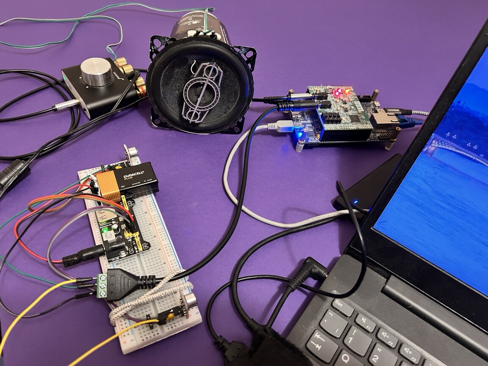

# DE10-Nano active noise cancellation

Independent engineering and research into adaptive control of low-frequency sound, combining FPGA signal processing, embedded Linux and acoustic experiments.

**Demonstrated:** two continuous 60-second adaptive-feedback runs while an external tone changed in level, phase and frequency around 200 Hz. Local target-tone RMS amplitude fell by **23.07%** and **22.62%** against the conservative reference. **The declared sustained attenuation target remains open.**

*Evidence snapshot: 5 November 2026. Overview prepared: 8 November 2026.*

<p align="center">
  
</p>

*Bench photograph, 7 November 2026. The laptop supplies the acoustic disturbance. Both MAX4466 microphones feed the Audio Mini; the RIGHT microphone supplies the feedback error. The photograph illustrates the later bench arrangement, rather than documenting the exact geometry of either 5 November run.*

## Measured result

| Physical experiment | Active feedback | Target-tone RMS reduction | Mean attenuation | One-second intervals reaching 3 dB |
| --- | ---: | ---: | ---: | ---: |
| Run A: correction rate 0.08, gain ceiling 64 | 60.003 s | 23.07% | 2.28 dB | 28 / 60 |
| Run B: correction rate 0.16, gain ceiling 96 | 60.003 s | 22.62% | 2.23 dB | 22 / 60 |

Both runs maintained feedback throughout the programmed source changes and ended disarmed. Separate software replays checked the applied feedback commands and watchdog renewals. The selected original measurements and offline replay are included here.

The sustained target requires **at least 3 dB mean attenuation and 54 of 60 one-second intervals reaching 3 dB**, with the control measurements within the permitted drift. Three decibels corresponds to approximately 29% RMS amplitude reduction. Neither run met the full target.

## System and engineering work

The platform uses a Terasic DE10-Nano, Audio Mini codec, two MAX4466 microphone modules, a Nobsound amplifier and a secondary loudspeaker. FPGA logic measures the tone and generates the secondary signal; an embedded C controller on the ARM/Linux side adjusts it. Acquisition uses both microphones; the demonstrated controller uses RIGHT feedback.

The work spans FPGA audio acquisition, coherent I/Q measurement, embedded control, Linux audio integration, acoustic-path calibration and reproducible experiment design. [System architecture](docs/system-overview.md)

## Scope and next milestone

The percentages describe the measured tone at one microphone position. They do not establish perceived loudness reduction, room-wide cancellation or broadband performance. Timing, calibrated acoustic output, repeatability and wider operating conditions remain qualification tasks.

The next experiment starts with diagnosis of the last attempt's preflight stop and verified progress/timeout handling, followed by a bounded comparison under the unchanged attenuation criteria. That stopped attempt produced no new physical attenuation result.

## Explore the evidence

- [Results, reference calculation and limitations](docs/results.md)
- [Original data and offline verification](evidence/README.md)
- [Source identities and publication scope](docs/provenance.md)
- [Licence and attribution](NOTICE.md)

```sh
python tools/verify_results.py
```

Python 3.10 or later; standard library only. The verifier reads local files and never connects to hardware. This overview contains selected evidence and documentation, not a deployable controller or FPGA image.

Project: **Neil Thomson**. Independent adviser: **Bruce W. Thomson**.

Released under the [GNU General Public License, version 3](LICENSE). See [NOTICE.md](NOTICE.md) for scope and attribution.
