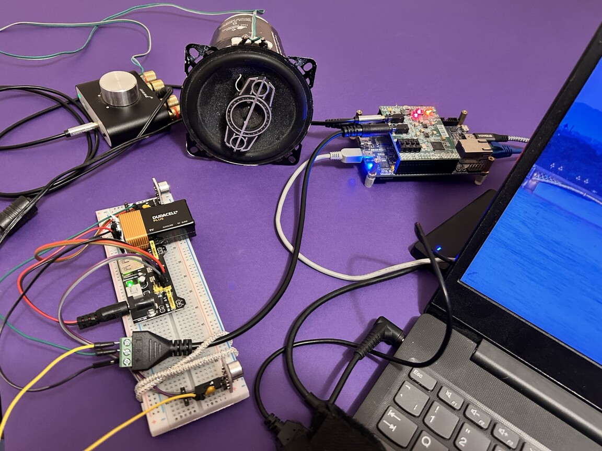

# DE10-Nano active noise cancellation

Independent engineering and research into adaptive control of low-frequency sound, combining FPGA signal processing, embedded Linux and acoustic experiments.

**The sustained 3 dB target was met on 21 November 2026.** Three 60-second adaptive runs attenuated the tracked external tone near 200 Hz by **5.64 dB, 6.15 dB and 5.70 dB** at the marked RIGHT microphone. All **180 of 180** one-second intervals exceeded 3 dB. The third run repeated the result on the same board after a reboot.

<p align="center">
  
</p>

*Bench photograph, 7 November 2026. The laptop generates the external test tone. The Audio Mini acquires both MAX4466 microphones. RIGHT supplies the feedback error. The photograph predates the 21 November trials.*

## Experimental results

Each adaptive minute on 21 November had its own zero-command source-only reference minute. Both used the same playback programme with changes in tone level, phase and frequency. Each start had to achieve at least 3 dB overall and at least 54 of 60 one-second intervals at or above 3 dB.

| 21 November matched pair | Overall attenuation | Target-tone RMS reduction | Intervals ≥3 dB | Weakest second |
| --- | ---: | ---: | ---: | ---: |
| First start | 5.64 dB | 47.74% | 60/60 | 3.21 dB |
| Repeat, same boot | 6.15 dB | 50.72% | 60/60 | 5.41 dB |
| After reboot | 5.70 dB | 48.09% | 60/60 | 4.82 dB |

The two 4–5 November runs achieved **2.28 dB** (23.07% RMS, 28/60 intervals) and **2.23 dB** (22.62% RMS, 22/60 intervals). Both missed their sustained criterion against a conservative reference derived from bracketing controls. The two series used different reference measurements. [Results and scoring for both dates](docs/results.md)

## System and engineering work

The platform uses a Terasic DE10-Nano, Audio Mini codec, two MAX4466 microphone modules, an amplifier and a secondary loudspeaker. FPGA logic measures the tone and generates the secondary signal; an embedded C controller on the ARM/Linux side adjusts it. Acquisition uses both microphones; the demonstrated controller uses RIGHT feedback.

The work spans FPGA audio acquisition, coherent I/Q measurement, embedded control, Linux audio integration, acoustic-path calibration and reproducible experiment design. [System architecture](docs/system-overview.md)

## Measurement scope

The measurements establish repeatability at one marked microphone position in this setup across two boots. The trials leave broadband attenuation, the spatial extent of the reduction and perceived loudness unmeasured. Independent laboratory replication remains open. The 21 November comparison used zero secondary drive as its reference. An adaptive-versus-fixed-command comparison would answer a separate question.

## Explore the evidence

- [Results, reference calculation and measurement scope](docs/results.md)
- [Measurement data and offline verification](evidence/README.md)
- [Source identities and publication scope](docs/provenance.md)
- [Licence and attribution](NOTICE.md)

```sh
python tools/verify_results.py
python tools/verify_tim035.py
```

Both commands run offline with Python 3.10 or later and the standard library. The first replays the 4–5 November experiments. The second scores the three 21 November matched pairs from the selected RIGHT I/Q measurements.

Project: **Neil Thomson**. Independent adviser: **Bruce W. Thomson**.

Released under the [GNU General Public License, version 3](LICENSE). See [NOTICE.md](NOTICE.md) for scope and attribution.
