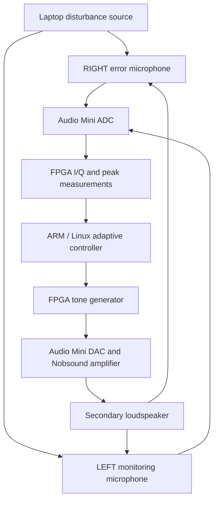

# System architecture

The demonstrated system is a narrowband acoustic feedback experiment around 200 Hz. Two microphones are acquired, but RIGHT supplies the error used by the adaptive controller. LEFT provides monitoring and checks. A two-microphone input path does not, by itself, establish feedforward or hybrid control.



The arrows from each loudspeaker represent acoustic propagation. The diagram shows functional relationships; it does not specify measured propagation delay or a qualified electrical wiring layout.

## Responsibilities

| Element | Role in the demonstrated system |
| --- | --- |
| Laptop built-in speakers | Independent acoustic disturbance, nominally 200 Hz with programmed changes |
| Two MAX4466 modules | Analogue microphone signals supplied to the Audio Mini |
| Audio Mini / AD1939 | Analogue-to-digital and digital-to-analogue audio conversion |
| DE10-Nano FPGA fabric | Audio handling, coherent I/Q tone measurement, peak monitoring and secondary-tone generation |
| DE10-Nano ARM processor under Linux | Embedded C adaptive control, operating checks and bounded experiment execution |
| Nobsound amplifier and secondary loudspeaker | Acoustic secondary path driven by the generated signal |
| Host and offline tools | Stimulus coordination, evidence transfer, arithmetic checking and recorded-command replay |

The sustained runs applied 50 feedback commands per second: 3,000 commands in each 60-second span. That nominal 20 ms update interval is distinct from audio sample rate and complete end-to-end latency. The latter has not been established by the cadence alone.

## Adaptive law and recorded checks

For the two published runs, the requested complex drive follows

```math
u_{k+1} = u_k - \mu \frac{e_k}{H}
```

followed by gain limiting, an eight-count maximum complex command step, and phase/gain quantisation. The initial error comes from the preceding reference windows. Subsequent updates use the preceding active I/Q window. The published replay uses the recorded correction rate, gain ceiling and complex secondary-path coefficient for each run.

The measured coefficient used by the original scorers is

```math
H = -302.87207031250017 + j 1879.4453125
```

Its units belong to the project's digital I/Q and drive representation. It is not a calibrated sound-pressure measurement or a generally transferable acoustic model.

Recorded checks include window sequence, microphone peak ceilings, applied-command acknowledgements, watchdog lease renewal, active duration and disarm. Their replay establishes consistency of the retained records. Complete electrical timing and analogue fault containment require separate physical qualification.

## Experimental geometry and interpretation

The sustained-session record gives microphone spacing of approximately seven inches, with the laptop source approximately seven inches from LEFT and ten inches from RIGHT. These are bench dimensions, not a controlled acoustic enclosure. The photograph was taken two days after the sustained trials and is not evidence that every component remained in precisely the trial position.

The source-to-microphone distance difference does not establish a usable feedforward reference: the demonstrated controller is RIGHT feedback. Acoustic transfer paths, background tones, secondary-speaker authority and controller limits can affect the residual. The two published settings were not replicated under identical backgrounds, so their difference does not establish a causal tuning improvement.

[Measured results](results.md) · [Evidence and replay](../evidence/README.md)
